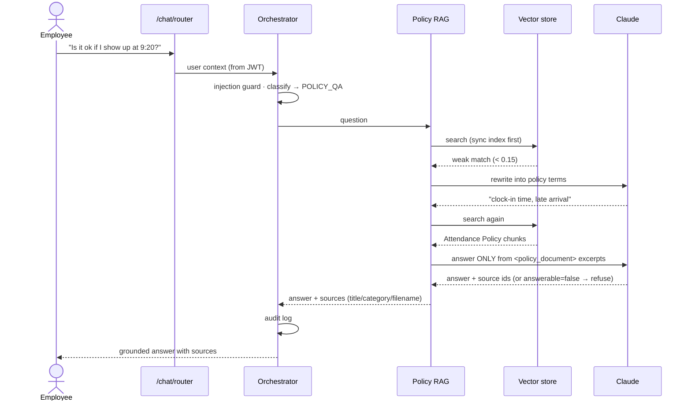
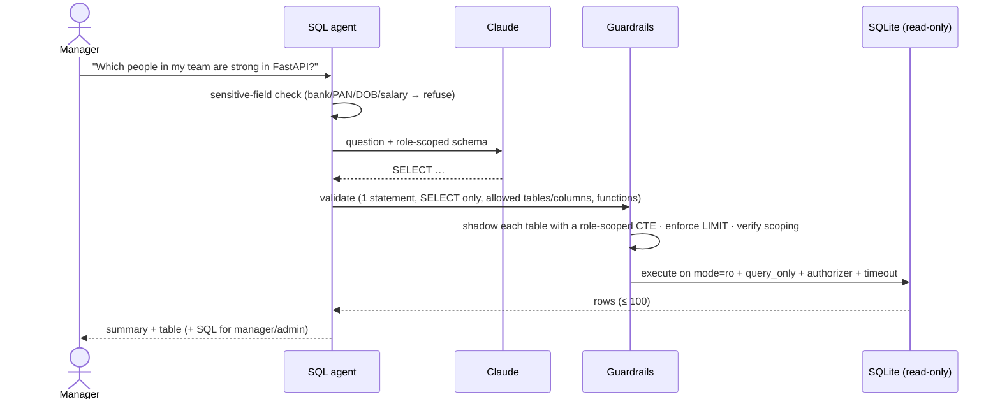
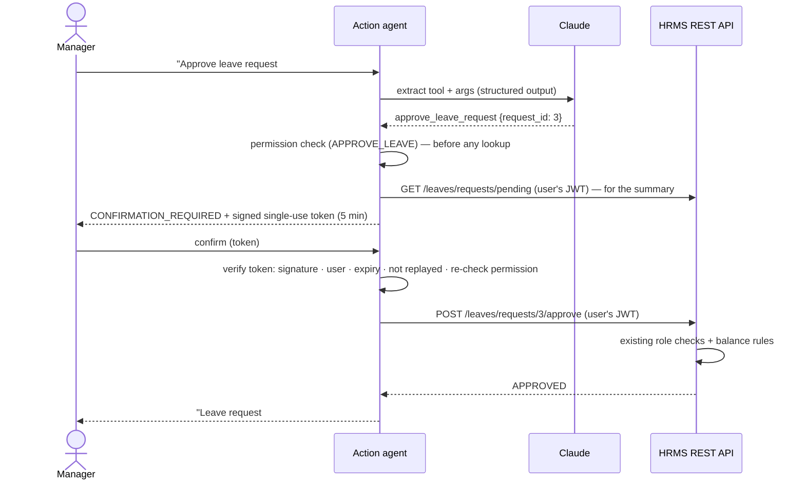

# NovaWorks PeopleOps Copilot — AI Architecture

The copilot adds four AI capabilities to CB Nest — a Policy RAG assistant, a read-only SQL agent, an HR action agent and an intent router — without bypassing the HRMS's existing authorization or business rules.

## 1. Architecture


### Request lifecycle

```text
User message → JWT verified (identity + role from DB, never from the message)
  → rate limit → injection / destructive-SQL guard → classify intent
  → agent: RAG retrieval | guarded SQL | backend API tool call
  → permission guardrails inside each agent → answer + sources / rows / action result
  → ai_audit_logs row (redacted) → JSON envelope {success, data, error}
```

### Policy question



### Data question



### HR action with human-in-the-loop



## 2. Components

| Component | Files | What it does |
|---|---|---|
| Policy RAG | `policy_rag.py`, `embeddings.py`, `vector_store.py` | Loads policies from `hr_policies` (file on disk → `.md/.txt/.pdf`, or `content`), chunks by markdown section (≤450 chars, heading carried as `[Heading]`), embeds, stores in `ai_policy_chunks`, retrieves top-k by cosine similarity, answers only from retrieved chunks, returns `title/category/filename` sources. With Claude, weak retrieval (best score < 0.15) or an "unanswerable" verdict triggers one query rewrite into HR-policy terms and a second search. The index re-syncs automatically when a policy is added, changed or deleted (content + embedder + chunker version hash). |
| SQL agent | `sql_agent.py`, `sql_guardrails.py` | NL → SQL (Claude with a role-scoped schema, or rule-based templates), then guardrails, then execution on a read-only connection. Returns `answer, sql (manager/admin only), columns, rows, row_count, truncated`. |
| HR action agent | `action_agent.py`, `api_tools.py`, `permissions.py` | Extracts a tool + arguments (Claude structured output or rule-based parser), checks permissions **before** any lookup, resolves names → ids via read APIs, asks for missing fields, requires confirmation for high-impact actions, then calls the existing REST API with the user's token. |
| Router | `orchestrator.py` | Deterministic security pre-checks, intent classification, dispatch, audit. |
| Audit | `audit.py`, `models/ai_audit_log.py`, migration `0017` | One row per interaction: user, role, redacted message, intent, agent, tool, status, record ids, latency. `GET /chat/audit` (own / all for admin) and `/chat/audit/stats` (admin usage dashboard data). |
| LLM client | `llm.py` | Claude via the official `anthropic` SDK with JSON-schema structured outputs; any failure returns `None` and the caller uses its rule-based path. |

## 3. Model / provider

- **Claude (`claude-opus-5-5`, configurable with `AI_MODEL`)** through the official Anthropic Python SDK. All calls use structured outputs (`output_config.format` JSON schema) so responses are machine-validated; `AI_EFFORT=low` keeps latency down for classification/extraction; server-side refusal fallback is enabled (`AI_REFUSAL_FALLBACK`).
- Used for: intent classification, SQL generation, action/argument extraction, grounded answer synthesis.
- **No key? Still works.** Every agent has a deterministic rule-based engine (the one the test-suite and eval run against). The LLM only ever *proposes* — SQL still passes guardrails, actions still pass permission checks and backend validation.
- **Embeddings:** a local, deterministic hashed embedding (unigrams + bigrams, HR synonym normalisation, light stemming, 4096 dims). No network, reproducible, good enough for a ~25-document policy library. `AI_EMBEDDING_BACKEND=fastembed` switches to a local ONNX sentence model (`BAAI/bge-small-en-v1.5`) and re-indexes automatically.

## 4. Endpoint contracts

All endpoints require `Authorization: Bearer <access_token>` and return the standard envelope.

Request (all chat endpoints):

```json
{ "message": "string, 1-2000 chars", "confirmation_token": "optional, from a CONFIRMATION_REQUIRED response" }
```

Common response fields: `answer, status, intent, confidence, reason, agent, provider, latency_ms`.
`status` ∈ `ANSWERED | NO_ANSWER | SUCCESS | CONFIRMATION_REQUIRED | NEEDS_INPUT | DENIED | BLOCKED | FAILED`.

`POST /api/v1/chat/policy`

```json
{"success": true, "error": null, "data": {
  "answer": "According to the Leave Policy: Sick leave: 10 days per year, for illness, recovery and medical appointments. …",
  "sources": [{"title": "Leave Policy", "category": "LEAVE", "filename": "seed_policy_01.md"}],
  "status": "ANSWERED", "intent": "POLICY_QA", "agent": "policy_rag", "provider": "rule-based", "latency_ms": 12 }}
```

`POST /api/v1/chat/sql`

```json
{"success": true, "error": null, "data": {
  "answer": "Found 1 result: Rahul Sharma",
  "sql": "SELECT e.name AS employee_name, … LIMIT 100",
  "columns": ["employee_name", "department", "skills"],
  "rows": [{"employee_name": "Rahul Sharma", "department": "Engineering", "skills": "FastAPI,Python"}],
  "row_count": 1, "truncated": false, "status": "ANSWERED", "intent": "SQL_QUERY" }}
```

`sql` is `null` for employees (raw SQL is visible to managers and admins only).

`POST /api/v1/chat/actions` — two-step for high-impact tools:

```json
// 1) "Approve Rahul Sharma's pending leave request."
{"data": {"status": "CONFIRMATION_REQUIRED", "tool": "approve_leave_request",
  "answer": "Approve leave request #1 from Rahul Sharma (Casual leave, 2026-12-01 to 2026-12-02)? Please confirm to proceed.",
  "confirmation": {"token": "<signed, single-use, 5 min>", "summary": "…", "expires_in_seconds": 300}}}
// 2) POST again with {"message": "confirm", "confirmation_token": "<token>"}
{"data": {"status": "SUCCESS", "answer": "Leave request #1 has been approved.", "result": {"id": 1, "status": "APPROVED", …}}}
```

Tools and their backend calls:

| Tool | Backend API | Confirmation |
|---|---|---|
| `create_leave_request` | `POST /api/v1/leaves/requests` | no |
| `get_leave_balances` / `list_my_leave_requests` | `GET /api/v1/leaves/balances/me`, `/requests/me` | no |
| `list_pending_leave_requests` | `GET /api/v1/leaves/requests/pending` | no |
| `approve_leave_request` / `reject_leave_request` | `POST /api/v1/leaves/requests/{id}/approve` · `/reject` | **yes** |
| `create_ticket` / `list_my_tickets` | `POST /api/v1/tickets` · `GET /api/v1/tickets?mine=true` | no |
| `assign_ticket` / `update_ticket_status` | `POST /api/v1/tickets/{id}/assign` · `/status` | **yes** |
| `create_announcement` | `POST /api/v1/announcements` | **yes** |
| `create_project` / `assign_employee_to_project` | `POST /api/v1/employees/projects/catalog` · `/employees/{id}/projects` | **yes** |

`POST /api/v1/chat/router` — same response shapes; picks the agent. `GET /api/v1/chat/capabilities` — role mode, capabilities and suggested prompts for the UI.

## 5. Security decisions

1. **Identity comes only from the verified JWT.** The role is read from the database on every request; nothing in the message can change who the user is.
2. **No direct writes by agents.** HR mutations go Agent → REST API (with the user's token) → existing service layer. A static test (`tests/test_architecture.py`) fails the build if AI code writes non-AI tables or contains write SQL.
3. **Defence in depth for SQL** — any single layer stops an attack:
   - keyword screen (INSERT/UPDATE/DELETE/DROP/ALTER/CREATE/REPLACE/TRUNCATE/PRAGMA/ATTACH/DETACH…), comments and multiple statements rejected;
   - AST validation with sqlglot: one `SELECT`/`UNION`, allow-listed tables per role, no schema-qualified names, no forbidden columns, no dangerous functions;
   - **row- and column-level scoping by CTE shadowing**: every referenced table is replaced by a same-named CTE exposing only safe columns and permitted rows (e.g. `leave_balances` = `WHERE employee_id = <me>` for employees, `+ direct reports` for managers). The unfiltered table is not reachable by name, so a generated query cannot "forget" a filter. A post-condition re-parses the final SQL and refuses to run if scoping is missing (fail closed);
   - execution on a separate `mode=ro` SQLite connection with `PRAGMA query_only` and an **authorizer callback** that denies every non-read operation and any read of a sensitive column, plus a timeout and a row cap.
4. **Sensitive data:** passwords, bank, PAN, date of birth and salary columns are never selectable (any role). Payroll (`gross/net`, without PAN/UAN/ESI) is admin-only. Requests for these fields are refused before any query runs, with wording that does not reveal whether a record exists.
5. **Permission check before lookup** in the action agent, so "Approve Rahul's leave" from an employee is refused without touching Rahul's data. The backend re-checks the role anyway.
6. **Human-in-the-loop** for approvals, ticket assignment/status, announcements and project changes: a signed, user-bound, 5-minute, single-use confirmation token carries the exact action; permissions are re-checked when it is redeemed.
7. **Prompt-injection defence:** user messages that try to override instructions are blocked deterministically before any LLM call; retrieved policy text is wrapped in `<policy_document>` tags and declared untrusted; in the extractive path, instruction-like sentences in documents are dropped (tested with a poisoned policy).
8. **Audit without secrets:** messages are redacted (JWTs, bearer tokens, API keys, passwords, PAN, IFSC, long account numbers) before storage; only record ids are logged, never record contents.
9. **Abuse limits:** per-user rate limit (30/min default) on AI endpoints, 2000-char message cap, SQL timeout and 100-row cap, raw DB errors never returned.
10. **Production config guard:** with `ENVIRONMENT=prod` the API refuses to start with a default/short `JWT_SECRET_KEY`; CORS origins are configuration, not code.

## 6. Key design decisions & trade-offs

- **Structured outputs + deterministic fallbacks** rather than a free-form agent loop: each LLM call does one well-defined job with a schema, which keeps behaviour predictable, testable offline and safe if the model misbehaves.
- **Router as plain code, not LangGraph.** The graph is linear (context → classify → agent → audit); a framework would add a dependency without adding control. The orchestrator is the obvious place to adopt LangGraph if multi-step plans are needed.
- **Vector store in the existing database** (`ai_policy_chunks`) instead of a separate service: the policy library is small, exact cosine search is fast, and deployment stays a single API container.
- **Manager scope = self + direct reports** for leave, job history, tickets and project assignments ("team only / limited" in the matrix); public catalog data (projects, skills, departments, directory fields) is visible to everyone, matching the existing employee directory.
- **Seed policy text was expanded** (Leave, Attendance, WFH, new Document Upload policy) to state the rules the code already enforces, so RAG answers match system behaviour. The original Attendance policy said "before 9:30 AM" while the attendance API marks arrivals after **09:00** as late; the policy now states 09:00 to match the system.

## 7. Known limitations

- Rate limiting and confirmation replay-protection are in-process; run one API worker (default) or move them to Redis before scaling horizontally.
- The rule-based engines cover the documented prompt patterns; open-ended phrasing benefits from setting `ANTHROPIC_API_KEY`.
- Hashed embeddings are lexical (with HR synonyms). With Claude, query rewriting recovers paraphrases; without an LLM, unusual phrasings can miss — enable `fastembed` for semantic recall.
- The SQL agent targets SQLite (read-only URI + authorizer). A Postgres deployment would use a read-only DB role and row-level security instead.
- Chat history is per page session (not persisted); the audit log is the durable record.
- No streaming responses; typical latency is milliseconds without an LLM and one model call (~1–3 s) with one.
