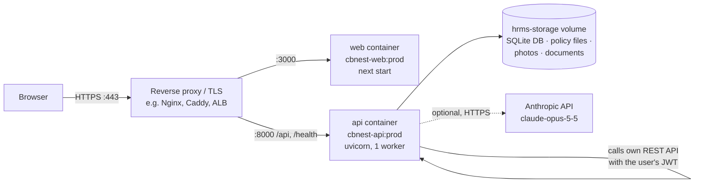

# Deployment & Operations Runbook

How to deploy, configure, operate and troubleshoot CB Nest with the PeopleOps Copilot in production.

## 1. Topology



| Component | Image | Port | State |
|---|---|---|---|
| `api` | `cbnest-api:prod` (`backend/Dockerfile`) | 8000 | `hrms-storage` volume mounted at `/app/storage` |
| `web` | `cbnest-web:prod` (`frontend/Dockerfile.prod`) | 3000 | stateless |

Both containers run as non-root users (`appuser`, `node`). The API applies Alembic migrations on every start (`docker-entrypoint.sh`) and exposes a Docker health check on `/health`; `web` starts only after `api` is healthy.

## 2. Prerequisites

- Docker Engine 24+ with Compose v2 (or Docker Desktop)
- A host with ~2 GB RAM, 2 GB disk for images plus data
- A TLS-terminating reverse proxy for any non-local deployment
- Optional: an Anthropic API key ([console.anthropic.com](https://console.anthropic.com) → API Keys)

## 3. Configuration

All backend settings are environment variables, read from `backend/.env` (git-ignored). Start from the template:

```bash
cp backend/.env.example backend/.env
```

### Required for production

| Variable | Value | Notes |
|---|---|---|
| `ENVIRONMENT` | `prod` | Set by `docker-compose.prod.yml`; enables startup checks |
| `JWT_SECRET_KEY` | 48+ random chars | `python3 -c "import secrets; print(secrets.token_urlsafe(48))"`. The API **refuses to start** in prod if it is default or shorter than 32 characters |
| `CORS_ORIGINS` | `https://hr.example.com` | Exact browser origin(s) of the frontend, comma-separated, no trailing slash |

### Frontend build argument

| Variable | Value | Notes |
|---|---|---|
| `PUBLIC_API_BASE_URL` | `https://api.hr.example.com` | Baked into the web image at build time (`NEXT_PUBLIC_API_BASE_URL`). Set it in the shell or a root `.env` before `docker compose build` |

### AI settings (optional)

| Variable | Default | Notes |
|---|---|---|
| `ANTHROPIC_API_KEY` | empty | Empty → deterministic rule-based engines (fully functional) |
| `AI_MODEL` | `claude-opus-5-5` | Any current Claude model id |
| `AI_EFFORT` | `low` | Claude effort; `medium` trades latency for depth |
| `AI_LLM_TIMEOUT_SECONDS` | `30` | Per Claude call; on timeout the rule-based path answers |
| `AI_REFUSAL_FALLBACK` | `true` | Server-side refusal fallback (beta) |
| `AI_INTERNAL_API_BASE_URL` | `http://127.0.0.1:8000` | Where the action agent calls the HRMS API (inside the same container) |
| `AI_SQL_MAX_ROWS` / `AI_SQL_TIMEOUT_SECONDS` | `100` / `5` | SQL agent limits |
| `AI_EMBEDDING_BACKEND` | `hashing` | `fastembed` for a local ONNX sentence model (needs `pip install fastembed`) |
| `AI_RAG_TOP_K` / `AI_RAG_MIN_SCORE` / `AI_RAG_REWRITE_BELOW_SCORE` | `4` / `0.05` / `0.15` | Retrieval tuning |
| `AI_RATE_LIMIT_PER_MINUTE` | `30` | Per user, AI endpoints only |
| `AI_CONFIRMATION_TTL_SECONDS` | `300` | Lifetime of human-in-the-loop confirmation tokens |

## 4. First deployment

```bash
git clone <repo-url> cbnest && cd cbnest
cp backend/.env.example backend/.env       # edit: JWT_SECRET_KEY, CORS_ORIGINS, ANTHROPIC_API_KEY
export PUBLIC_API_BASE_URL=https://api.hr.example.com

docker compose -f docker-compose.prod.yml up -d --build
docker compose -f docker-compose.prod.yml ps                       # api: healthy
docker compose -f docker-compose.prod.yml exec api python scripts/seed.py   # demo data, first run only
```

Smoke-test the deployment end to end (uses the seeded demo users):

```bash
cd backend && python scripts/live_eval.py --base-url https://api.hr.example.com
```

> `scripts/seed.py` **deletes all data** and loads demo users. Never run it against real data.

## 5. Upgrades

```bash
git pull
docker compose -f docker-compose.prod.yml up -d --build    # migrations run automatically on API start
docker compose -f docker-compose.prod.yml logs api | grep -E "Running upgrade|startup"
```

Back up the volume (section 7) before upgrades that include migrations (`backend/alembic/versions/`).

## 6. Day-2 operations

| Task | Command |
|---|---|
| Status / health | `docker compose -f docker-compose.prod.yml ps` · `curl -s localhost:8000/health` |
| Logs | `docker compose -f docker-compose.prod.yml logs -f api` — each AI request logs `ai.request user_id=… role=… intent=… status=… tool=… latency_ms=…` |
| AI usage metrics (admin) | `GET /api/v1/chat/audit/stats` — totals, intents, statuses, denied/blocked counts, RAG no-answer rate, average latency |
| AI audit trail | `GET /api/v1/chat/audit?scope=all&limit=100` (admin) or the `ai_audit_logs` table |
| Re-index policies | Automatic before each policy question; manual: `POST /api/v1/chat/policy/reindex` (admin/manager) |
| Restart | `docker compose -f docker-compose.prod.yml restart api` |
| Disable Claude temporarily | set `AI_LLM_ENABLED=false` in `backend/.env`, then `up -d api` |

### Rotating secrets

- **JWT secret:** set a new `JWT_SECRET_KEY`, run `docker compose -f docker-compose.prod.yml up -d api`. All sessions and pending confirmation tokens become invalid; users log in again.
- **Anthropic key:** create a new key in the console, update `ANTHROPIC_API_KEY`, `up -d api`, then revoke the old key. Rotate immediately if a key is ever pasted into chat, tickets or logs.

## 7. Backup & restore

The only state is the `hrms-storage` volume (SQLite DB and uploaded files).

```bash
# backup (consistent copy using SQLite's online backup)
docker compose -f docker-compose.prod.yml exec api python -c \
  "import sqlite3; s=sqlite3.connect('storage/hrms.db'); d=sqlite3.connect('storage/backup.db'); s.backup(d); d.close()"
docker run --rm -v capstone_project_hrms-storage:/data -v "$PWD":/out alpine \
  tar czf /out/hrms-storage-$(date +%F).tgz -C /data .

# restore
docker compose -f docker-compose.prod.yml down
docker run --rm -v capstone_project_hrms-storage:/data -v "$PWD":/in alpine \
  sh -c "rm -rf /data/* && tar xzf /in/hrms-storage-YYYY-MM-DD.tgz -C /data"
docker compose -f docker-compose.prod.yml up -d
```

(The volume name is `<compose project>_hrms-storage`; check with `docker volume ls`.)

## 8. Scaling notes

- Run **one API worker** (default). The AI rate limiter and the confirmation-token replay store are in-process; before raising `WEB_CONCURRENCY` or running multiple replicas, move both to a shared store (e.g. Redis).
- SQLite suits a single-host deployment. For multi-host, migrate to Postgres; the SQL agent's read-only enforcement would then use a read-only DB role plus row-level security instead of the SQLite authorizer.
- Claude calls dominate latency (p50 ≈ 3.8 s per copilot request); the rule-based engine answers in milliseconds.

## 9. Security checklist

- [ ] `ENVIRONMENT=prod`, strong `JWT_SECRET_KEY`, exact `CORS_ORIGINS`
- [ ] TLS at the reverse proxy; only 443 exposed publicly (8000/3000 bound to the private network)
- [ ] `backend/.env` readable only by the deploy user; never committed (CI secret scan enforces)
- [ ] Demo seed users removed or passwords changed before real use
- [ ] Volume backups scheduled
- [ ] Anthropic key scoped to this service and rotated on exposure

## 10. Troubleshooting

| Symptom | Likely cause | Fix |
|---|---|---|
| API exits with `JWT_SECRET_KEY must be set…` | Weak/default secret with `ENVIRONMENT=prod` | Set a 32+ char random secret |
| Browser console: CORS error | `CORS_ORIGINS` does not exactly match the page origin | Match scheme, host and port exactly; restart `api` |
| Frontend calls the wrong API host | `PUBLIC_API_BASE_URL` was not set at build time | Export it and `docker compose … up -d --build web` |
| Copilot shows `Engine: rule-based` | No/empty `ANTHROPIC_API_KEY`, or `AI_LLM_ENABLED=false` | Set the key; `up -d api` |
| Copilot answers but slowly / falls back | Claude timeouts or rate limits | Check `ai.llm.*` warnings in API logs; raise `AI_LLM_TIMEOUT_SECONDS` |
| HTTP 429 "Too many AI requests" | Per-user AI rate limit | Wait a minute or raise `AI_RATE_LIMIT_PER_MINUTE` |
| HR action fails with "HR system is unavailable" | `AI_INTERNAL_API_BASE_URL` not reachable from the API container | Keep the default `http://127.0.0.1:8000` inside the container |
| Policy answers miss a newly uploaded file | Index not refreshed yet / unreadable file | Ask again (auto-sync) or `POST /api/v1/chat/policy/reindex`; check `ai.rag.policy_unreadable` in logs |
| Logged-in users suddenly get 401 | JWT secret rotated | Expected; log in again |
